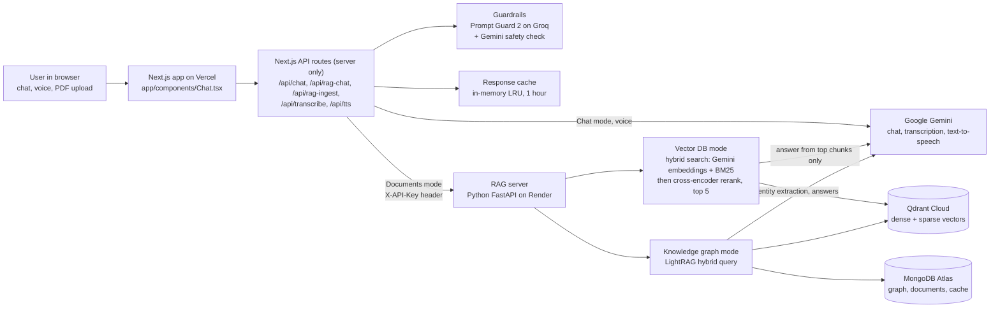

# Architecture

## Request flows

**Chat mode** (`/api/chat`)
1. The browser sends the conversation and the selected model.
2. The route validates every message and checks the model against an allowlist (`app/lib/models.ts`).
3. Guardrails on: Prompt Guard and the Gemini safety check run in parallel on the latest message. Blocked messages never reach the model.
4. The response cache is checked (key = model + whole conversation).
5. Gemini answers. Guardrails off: streamed word by word. Guardrails on: generated in full, checked by the output guard, then sent.

**Documents mode** (`/api/rag-chat` -> RAG server `/chat` or `/kg/chat`)
1. Same validation and input guardrails as chat.
2. The route forwards the question to the RAG server with the `X-API-Key` password.
3. **Vector DB:** the question is embedded; hybrid search (meaning + keywords) returns 20 chunks; the reranker keeps the 5 that best answer it; Gemini answers only from those, citing pages, or says it couldn't find the answer.
4. **Knowledge graph:** LightRAG matches entities (local) and themes (global) in the graph built at upload time, and answers with page references. Earlier turns are used, so follow-ups work.
5. The output guardrail checks the answer; the browser shows it with a Sources line.

**Upload** (`/api/rag-ingest` -> `/ingest` or `/kg/ingest`)
- Vector DB: PDF -> pages -> 1000-character chunks (150 overlap) -> dense + sparse vectors -> Qdrant.
- Knowledge graph: runs in the background; Gemini extracts entities and relationships page by page; the browser polls progress.

**Voice:** `/api/transcribe` (Gemini speech-to-text) and `/api/tts` (Gemini text-to-speech, WAV).

## Security boundaries
- API keys live only in server environment variables, never in the browser.
- Every API route validates input; only allowlisted models can be requested.
- The RAG server rejects requests without the shared `RAG_API_KEY`.
- Guardrails check user input and model output (retrieved document text is not scanned yet).
