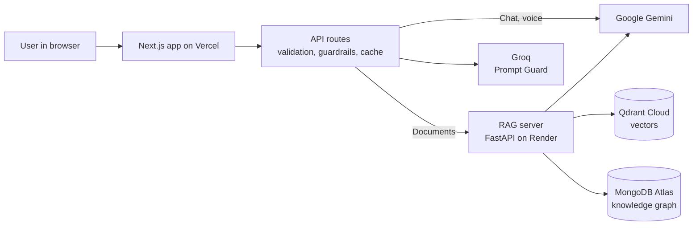

# Gemini RAG Assistant

Ask questions about your own PDFs and get answers with page citations, protected by guardrails, by text or voice.

**Live:** https://gemini-ai-chat-coral.vercel.app
**RAG backend repo:** https://github.com/deekshithlanka/rag-backend

## Features

| Feature | What it does |
|---|---|
| Chat | Gemini chat with model selection (server-side allowlist), streaming answers, Stop button |
| Documents mode (RAG) | Upload a PDF, ask questions; answers cite pages and say when the answer isn't in the documents |
| Hybrid search + reranking | Meaning + keyword search finds 20 chunks; a cross-encoder keeps the best 5, scored 0-1 |
| Knowledge graph | LightRAG graph of entities and relationships for questions that connect ideas |
| Guardrails | Prompt Guard 2 (jailbreak / prompt injection) and a Gemini safety check on input and output |
| Response cache | Repeated questions answered instantly (Cached label) |
| Voice | Speech-to-text input and read-aloud answers |

## Architecture



Full diagram and request flows: [ARCHITECTURE.md](ARCHITECTURE.md).

## Tech stack
Next.js (React, TypeScript, Tailwind) · Google Gemini (`@google/genai`) · Groq · Python FastAPI · LangChain · Qdrant · LightRAG · MongoDB Atlas · fastembed · Vercel · Render

## Run locally

```bash
npm install
cp .env.local.example .env.local   # fill in the keys below
npm run dev                        # http://localhost:3000
```

| Variable | Purpose |
|---|---|
| `GOOGLE_GENAI_API_KEY` | Gemini (chat, safety check, voice) |
| `GROQ_API_KEY` | Prompt Guard guardrail (optional; skipped if missing) |
| `RAG_API_URL` | RAG server, e.g. `http://localhost:8001` or the Render URL |
| `RAG_API_KEY` | Password for the RAG server (only if it has one set) |

Documents mode needs the [rag-backend](https://github.com/deekshithlanka/rag-backend) server running.

## Project structure
- `app/components/Chat.tsx`: chat UI (modes, upload, rerank, guardrails, voice, sources)
- `app/components/Markdown.tsx`: renders formatted answers
- `app/api/chat/route.ts`: Gemini chat with guardrails, cache, streaming
- `app/api/rag-chat/route.ts`, `app/api/rag-ingest/route.ts`: proxy to the RAG server
- `app/api/transcribe/route.ts`, `app/api/tts/route.ts`: voice
- `app/lib/guardrails.ts`, `app/lib/responseCache.ts`, `app/lib/models.ts`, `app/lib/rag.ts`

## Known limitations
- Free Render server sleeps after 15 minutes idle (first request about 1 minute).
- The cache is per server instance on Vercel.
- Uploads over about 4 MB exceed Vercel's request size limit.
- Retrieved document text is not scanned for prompt injection yet.
